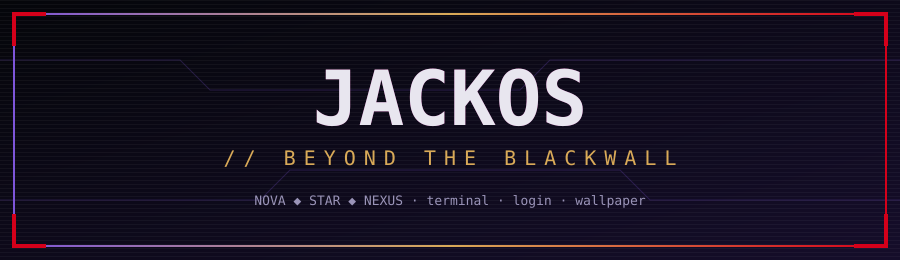

<p align="center"></p>

<p align="center">
<code>KDE Plasma 6</code> · <code>Wayland</code> · <code>Kubuntu / Ubuntu 26.04</code> · <code>Bash</code>
</p>

> **Más allá del Blackwall hay una red propia.** Kit de personalización de **JackOS**: escritorio oscuro, violeta y dorado, con acento rojo Arasaka, donde la terminal, el login y el fondo respiran la misma estética. Sacado de mi PC, listo para adaptarlo al tuyo.


## ▌01 · QUÉ HAY EN LA RED

| Nodo | Carpeta | Qué hace |
|---|---|---|
| ⌨️ **Terminal** | [`jackos-terminal.sh`](jackos-terminal.sh) | `fzf` (Ctrl+R / Ctrl+T / Alt+C) con colores JackOS, `zoxide` (`z carpeta`), `eza` con iconos y estado de git, `bat` en lugar de `cat` |
| 🖥️ **Konsole** | [`konsole/`](konsole) | Perfil **JackOS** + esquema `CyberpunkCapri`, JetBrainsMono Nerd Font, cursor rojo Blackwall |
| 🔐 **Login (SDDM)** | [`sddm/jackos-sovereign`](sddm/jackos-sovereign) | Pantalla de inicio de sesión animada: anillos orbitales, núcleo de estrella, reloj y teclado |
| 🌌 **Splash de Plasma** | [`splash/JackOS.splash`](splash/JackOS.splash) | Pantalla de carga con título glitch y barra de progreso violeta |
| 🧬 **Fondo animado** | [`animado/generar.py`](animado/generar.py) | Genera un loop 1080p (pulso, barrido, energía por grietas, datos cayendo, glitch) desde cualquier imagen. Adaptado del generador de Blackwall-Kubuntu |
| 🎞️ **Fondo de video** | [`wallpaper/`](wallpaper) | Wallpaper animado en Plasma 6 con decodificación por hardware (VA-API): ~6 % de CPU en vez de ~101 % |


## ▌02 · PALETA

| Rol | Color |
|---|---|
| Fondo obsidiana | `#05060a` / `#0c0e1b` |
| Violeta (foco, prompt) | `#7d55d9` |
| Dorado (acentos, resaltado) | `#d9aa58` |
| Rojo Blackwall (cursor, alertas) | `#d4001a` |
| Texto | `#e8e6ef` |


## ▌03 · JACK-IN (instalación)

```bash
git clone https://github.com/JackStar6677-1/jackos
cd jackos
./install.sh                          # terminal + Konsole (sin sudo)
sudo apt install fzf eza bat zoxide   # opcional pero recomendado
```

Abre una ventana nueva de Konsole y elige el perfil **JackOS**.

**Login animado (SDDM)**, pruébalo antes de activarlo:

```bash
kpackagetool6 --type Plasma/LookAndFeel --install splash/JackOS.splash   # splash (opcional)
sudo cp -r sddm/jackos-sovereign /usr/share/sddm/themes/
sddm-greeter-qt6 --test-mode --theme /usr/share/sddm/themes/jackos-sovereign
printf '[Theme]\nCurrent=jackos-sovereign\n' | sudo tee /etc/sddm.conf.d/30-jackos.conf
```

Si el login no carga, desde una TTY (`Ctrl+Alt+F3`): `sudo rm /etc/sddm.conf.d/30-jackos.conf && sudo reboot`.


## ▌04 · FONDO DE VIDEO (Plasma 6 + Wayland)

Plugin: **Smart Video Wallpaper Reborn** (Configuración → Fondo de pantalla → Obtener nuevos).

Tres trampas que me costaron una tarde entera:

1. `QT_MEDIA_BACKEND=gstreamer` deja el escritorio **negro** sin dar ningún error. Usa `ffmpeg`.
2. `ffmpeg` decodifica por software y un video 2560×1600 se come un núcleo entero. Con `QT_FFMPEG_DECODING_HW_DEVICE_TYPES=vaapi` baja a ~6 %.
3. Escribe la configuración del wallpaper con `plasmashell` cerrado, o se pisa al salir.

Las dos variables están en [`wallpaper/90-qt-media-vaapi.conf`](wallpaper/90-qt-media-vaapi.conf): cópialas a `~/.config/environment.d/` y reinicia sesión.

### Fondo animado propio
```bash
pip install pillow numpy   # y ffmpeg
python3 animado/generar.py --base mi_fondo.png --size 1920x1080 --secs 10
```
Usa el `.mp4` resultante con el plugin de arriba. El `generar.py` es una adaptación del de [Blackwall-Kubuntu](https://github.com/DrgX89/Blackwall-Kubuntu) (Nixcobt).

### Fondo ASCII (tarea para Nix)
Convierte un video corto en loop a estilo ASCII/terminal, expórtalo en H.264 a 15–24 fps y úsalo como fondo. **Mi video no va en el repo**: pesa cientos de MB y deriva de material con copyright. Hazte el tuyo.


## ▌05 · ARRANQUE Y CURSORES

Para GRUB, conky y cursores mira el repo de **Nix**: [Blackwall-Kubuntu](https://github.com/DrgX89/Blackwall-Kubuntu) (GRUB negro con selección roja, JetBrains Mono). Los cursores los probé y no me convencieron, así que aquí no van.

<p align="center"><sub>JackOS // hecho en Nova · wake the f*** up, samurai.</sub></p>
