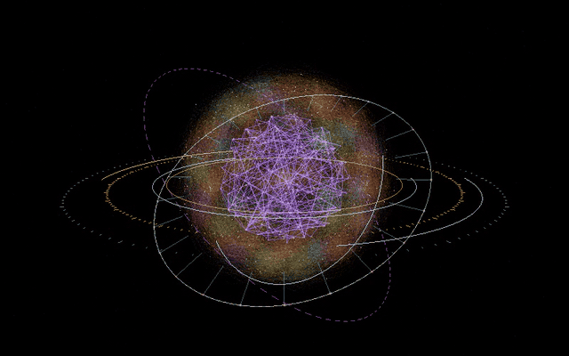

<p align="center"></p>

<p align="center">
<code>KDE Plasma 6</code> · <code>Wayland</code> · <code>Kubuntu / Ubuntu 26.04</code> · <code>Bash</code>
</p>

> **Más allá del Blackwall hay una red propia.** Kit de personalización de **JackOS**: escritorio oscuro, violeta y dorado, con acento rojo Arasaka, donde la terminal, el login y el fondo respiran la misma estética. Sacado de mi PC, listo para adaptarlo al tuyo.


## ▌00 · PANEL EN VIVO

<table>
<tr>
<td align="center" width="50%"><br><sub><b>Esfera Jarvis</b> · grafos en la GPU, anillos HUD, flota en órbita</sub></td>
<td align="center" width="50%"><br><sub><b>Terminal JackOS</b> · fastfetch Blackwall, fzf, zoxide, eza, bat · prompt con estado</sub></td>
</tr>
</table>


## ▌01 · QUÉ HAY EN LA RED

| Nodo | Carpeta | Qué hace |
|---|---|---|
| ⌨️ **Terminal** | [`jackos-terminal.sh`](jackos-terminal.sh) | `fzf` (Ctrl+R / Ctrl+T / Alt+C) con colores JackOS, `zoxide` (`z carpeta`), `eza` con iconos y estado de git, `bat` en lugar de `cat` |
| 🖥️ **Konsole** | [`konsole/`](konsole) | Perfil **JackOS** + esquemas `CyberpunkCapri` y **`JackOS-Blackwall`** (rojo, morado, dorado, 82 % de opacidad con blur), JetBrainsMono Nerd Font, cursor rojo |
| 👁️ **Fastfetch** | [`fastfetch/`](fastfetch) | Ficha del sistema con el ojo del Blackwall en rojo/morado/dorado; barras de uso en morado → dorado → rojo |
| 🔐 **Login (SDDM)** | [`sddm/jackos-sovereign`](sddm/jackos-sovereign) | Pantalla de inicio de sesión animada: anillos orbitales, núcleo de estrella, reloj y teclado |
| 🌌 **Splash de Plasma** | [`splash/JackOS.splash`](splash/JackOS.splash) | Pantalla de carga con título glitch y barra de progreso violeta |
| 🧬 **Fondo animado** | [`animado/generar.py`](animado/generar.py) | Genera un loop 1080p (pulso, barrido, energía por grietas, datos cayendo, glitch) desde cualquier imagen. Adaptado del generador de Blackwall-Kubuntu |
| 🔮 **Esfera Jarvis** | [`esfera/`](esfera) | Bola 3D de grafos vivos en la GPU con anillos HUD, flota en órbita y pulsos. Se usa como **widget flotante** transparente sobre tu fondo o se renderiza a video en bucle |
| 🎞️ **Fondo de video** | [`wallpaper/`](wallpaper) | Wallpaper animado en Plasma 6 con decodificación por hardware (VA-API): ~6 % de CPU en vez de ~101 % |
| 📊 **Barra: Monitor** | [`plasma/org.jackos.monitor`](plasma/org.jackos.monitor) | Plasmoide de sensores en celdas neón con esquinas cortadas; sensor, etiqueta, color y orden editables desde la configuración |
| 📡 **Barra: Ticker** | [`plasma/org.jackos.ticker`](plasma/org.jackos.ticker) | Cinta Blackwall que rellena la barra: mensajes editables, flujo hex vivo y glitch ocasional |


## ▌02 · PALETA

| Rol | Color |
|---|---|
| Fondo obsidiana | `#05060a` / `#0c0e1b` |
| Violeta (foco, prompt) | `#7d55d9` |
| Dorado (acentos, resaltado) | `#d9aa58` |
| Rojo Blackwall (cursor, alertas) | `#d4001a` |
| Texto | `#e8e6ef` |


## ▌03 · JACK-IN (instalación)

```bash
git clone https://github.com/JackStar6677-1/jackos
cd jackos
./install.sh lista                    # ver las partes
./install.sh todo                     # terminal + barra + esfera + wallpaper + splash (sin sudo)
./install.sh terminal barra           # o solo lo que quieras, por partes
./install.sh sddm                     # login animado: pide sudo y NO lo activa
sudo apt install fastfetch fzf eza bat zoxide   # opcional pero recomendado
```

| Parte | Qué instala |
|---|---|
| `terminal` | bash (fzf, zoxide, eza, bat), perfil y esquema Blackwall de Konsole, fastfetch |
| `barra` | plasmoides JackOS Monitor y Ticker |
| `esfera` | esfera Jarvis como widget flotante (`jackos-esfera`) |
| `wallpaper` | variables VA-API para fondo de video fluido |
| `splash` | pantalla de carga de Plasma |
| `sddm` | login animado (sudo; la activas tú, con rescate documentado) |

Abre una ventana nueva de Konsole y elige el perfil **JackOS**.

### Replicar la terminal (como en la foto)

1. `./install.sh` copia el perfil y el esquema de Konsole (`JackOS-Blackwall`: rojo, morado y dorado, 82 % de opacidad con blur), la config de `fastfetch` y los alias.
2. Instala la fuente **JetBrainsMono Nerd Font** (sin ella faltan los iconos de la ficha) y `fastfetch`: `sudo apt install fastfetch`.
3. Abre Konsole con el perfil **JackOS**; para la transparencia en Wayland activa *Desenfoque del fondo* en *Configuración → Editar perfil actual → Apariencia* si no se aplica sola.
4. **Tu propio logo:** la ficha usa `fastfetch/logo-blackwall.txt` (el ojo del Blackwall). Para poner otro, guarda tu arte (ASCII o Braille) en un `.txt`, apunta `"logo" → "source"` de `~/.config/fastfetch/config.jsonc` a él y colorea por bloques con `$1`, `$2`, `$3` al inicio de cada línea (rojo, morado, dorado). Hay arte hecho en [emojicombos.com](https://emojicombos.com/cyberpunk-edgerunners-ascii-art); revisa su licencia antes de publicarlo.

**Login animado (SDDM)**, pruébalo antes de activarlo:

```bash
kpackagetool6 --type Plasma/LookAndFeel --install splash/JackOS.splash   # splash (opcional)
sudo cp -r sddm/jackos-sovereign /usr/share/sddm/themes/
sddm-greeter-qt6 --test-mode --theme /usr/share/sddm/themes/jackos-sovereign
printf '[Theme]\nCurrent=jackos-sovereign\n' | sudo tee /etc/sddm.conf.d/30-jackos.conf
```

Si el login no carga, desde una TTY (`Ctrl+Alt+F3`): `sudo rm /etc/sddm.conf.d/30-jackos.conf && sudo reboot`.


## ▌04 · FONDO DE VIDEO (Plasma 6 + Wayland)

Plugin: **Smart Video Wallpaper Reborn** (Configuración → Fondo de pantalla → Obtener nuevos).

Tres trampas que me costaron una tarde entera:

1. `QT_MEDIA_BACKEND=gstreamer` deja el escritorio **negro** sin dar ningún error. Usa `ffmpeg`.
2. `ffmpeg` decodifica por software y un video 2560×1600 se come un núcleo entero. Con `QT_FFMPEG_DECODING_HW_DEVICE_TYPES=vaapi` baja a ~6 %.
3. Escribe la configuración del wallpaper con `plasmashell` cerrado, o se pisa al salir.

Las dos variables están en [`wallpaper/90-qt-media-vaapi.conf`](wallpaper/90-qt-media-vaapi.conf): cópialas a `~/.config/environment.d/` y reinicia sesión.

### Fondo animado propio
```bash
pip install pillow numpy   # y ffmpeg
python3 animado/generar.py --base mi_fondo.png --size 1920x1080 --secs 10
```
Usa el `.mp4` resultante con el plugin de arriba. El `generar.py` es una adaptación del de [Blackwall-Kubuntu](https://github.com/DrgX89/Blackwall-Kubuntu) (Nixcobt).

### Fondo ASCII (tarea para Nix)
Convierte un video corto en loop a estilo ASCII/terminal, expórtalo en H.264 a 15–24 fps y úsalo como fondo. **Mi video no va en el repo**: pesa cientos de MB y deriva de material con copyright. Hazte el tuyo.


## ▌04b · BARRA Y DOCK (Plasma 6)


<p align="center"></p>

Dos plasmoides propios, sin dependencias, que reemplazan a los monitores de KDE (cuyas etiquetas se recortaban):

```bash
cp -r plasma/org.jackos.monitor plasma/org.jackos.ticker ~/.local/share/plasma/plasmoids/
```

Luego clic derecho en el panel → *Añadir widgets* → **JackOS Monitor** y **JackOS Ticker** (el ticker se estira solo por el hueco libre). Todo se edita con clic derecho → *Configurar*. El **dock** va flotante, centrado, de 60 px y se oculta solo cuando una ventana lo tapa (`hiding = dodgewindows`). Para el fondo negro de barra y dock, pon `BackgroundNormal=0,0,0` en `[Colors:Window]` de `colors` de tu tema en `~/.local/share/plasma/desktoptheme/<tema>/`.


## ▌05 · ARRANQUE Y CURSORES

Para GRUB, conky y cursores mira el repo de **Nix**: [Blackwall-Kubuntu](https://github.com/DrgX89/Blackwall-Kubuntu) (GRUB negro con selección roja, JetBrains Mono). Los cursores los probé y no me convencieron, así que aquí no van.


## ▌06 · INTEGRACIÓN WINDOWS & WALLPAPER ENGINE

Para usar la interfaz y el ecosistema en entornos **Windows 11**:

### 1. JackOS Bridge (Acceso Seguro & Micrófono)
Carpeta: [`windows/`](windows/)
* **`jackos_bridge.py`**: Proxy local multihilo en `127.0.0.1:8096` hacia el VPS Star (`100.114.161.74:8096`).
* **Trusted Origin (Secure Context)**: Resuelve la restricción de navegadores modernos (Brave, Chrome) que bloquean la API de reconocimiento de voz (micrófono) en IPs HTTP directas, permitiendo hablar con SAORI sin tocar flags de seguridad.
* **`INICIAR_JACKOS_HUD.bat`**: Lanza el bridge y abre Brave en modo ventana de aplicación (`--app=http://localhost:8096/jarvis.html`).

### 2. Wallpaper Engine · SAORI Holographic Core (Audio-Reactivo)
Carpeta: [`wallpaper-engine-saori/`](wallpaper-engine-saori/)
* Proyecto interactivo para **Wallpaper Engine** que recrea el núcleo holográfico 3D de SAORI con el estilo de millones de entrelazamientos del grafo de Star (134.668 nodos, 366.093 aristas reales y 17 contenedores en órbita).
* **Reactivo a sonidos / música**: Escucha el espectro de audio mediante `window.wallpaperRegisterAudioListener`. Los graves generan ondas de choque expansivas en los anillos orbitales y pulsan el núcleo; los medios y agudos encienden los filamentos de la nube neural.
* **Personalización en vivo**: 5 paletas de color configurables desde Wallpaper Engine (*JackOS*, *Cyberpunk Cyan*, *Blood Orange*, *Matrix Emerald*, *Deep Violet*), velocidad de rotación, post-procesado UnrealBloom y alternador de anillos. Incluye `preview.bat` para prueba directa en navegador.

<p align="center"><sub>JackOS // hecho en Nova · wake the f*** up, samurai.</sub></p>
